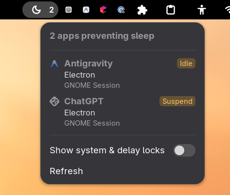

# Sleep Inhibitors (GNOME Shell Extension)

A GNOME Shell (45–51) top-bar extension that lists applications and processes currently preventing your computer from sleeping or going idle.



## Features

- **Dual inhibitor sources**:
  - **systemd-logind** (`org.freedesktop.login1` on the system D-Bus) — shows CLI tools (`systemd-inhibit`), downloaders, system services, and processes holding sleep/idle locks (with PID).
  - **GNOME Session Manager** (`org.gnome.SessionManager` on the session D-Bus) — shows desktop apps (browsers, video players, Flatpak apps) inhibiting Suspend or Idle, with resolved app names and icons.
- **Unobtrusive top-bar indicator**:
  - Dimmed moon icon when nothing is blocking sleep.
  - Bright icon with a numeric badge count when one or more apps are actively blocking sleep/idle.
- **Signal-driven + on-demand updates**:
  - Reacts immediately to `org.freedesktop.login1` `PropertiesChanged` and `org.gnome.SessionManager` `InhibitorAdded` / `InhibitorRemoved` signals, refreshes whenever the dropdown menu is opened, and runs a lightweight 10-second fallback poll.
- **Optional system & delay lock view**:
  - By default, filters out background `delay` locks (e.g., NetworkManager, UPower) and hardware key locks (`handle-lid-switch`, `handle-power-key`) so you only see actual sleep/idle blockers.
  - Toggle **"Show system & delay locks"** in the dropdown menu to inspect every active lock.

## Installation

```bash
make install
```

Then restart GNOME Shell (log out and back in on Wayland, or press `Alt+F2` → `r` → `Enter` on X11) and enable the extension:

```bash
gnome-extensions enable sleep-inhibitors@rveguilla.github.io
```

Or build a distributable archive:

```bash
make pack
gnome-extensions install --force sleep-inhibitors@rveguilla.github.io.shell-extension.zip
```

## Testing It Live

You can test the indicator immediately from a terminal using `systemd-inhibit`:

```bash
systemd-inhibit --what=sleep --who="Test App" --why="Testing sleep inhibitor indicator" sleep 30
```

The top-bar icon should brighten with a count of `1`, and clicking it will list **Test App** (`Testing sleep inhibitor indicator`) for 30 seconds.

You can also run the included unit tests and syntax checks:

```bash
make check
make test
```

## Debugging

To view extension logs on your GNOME desktop:

```bash
journalctl -f -o cat /usr/bin/gnome-shell
```

## Releasing

Pushing a version tag (e.g. `v1.0.0`) triggers the [CI & Release](.github/workflows/ci.yml) GitHub Actions workflow, which validates `metadata.json`, runs `make check` and `make test`, builds the `.shell-extension.zip` bundle via `make pack`, verifies the archive contents, and publishes a GitHub Release with the zip attached:

```bash
git tag v1.0.0
git push origin v1.0.0
```

## License

This project is licensed under the [GNU General Public License v3.0 or later](LICENSE) (`GPL-3.0-or-later`).
